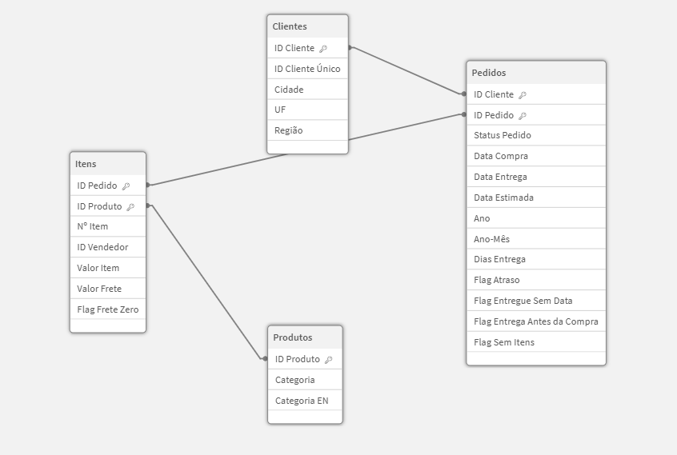
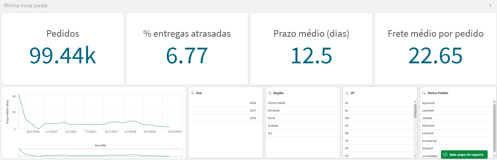
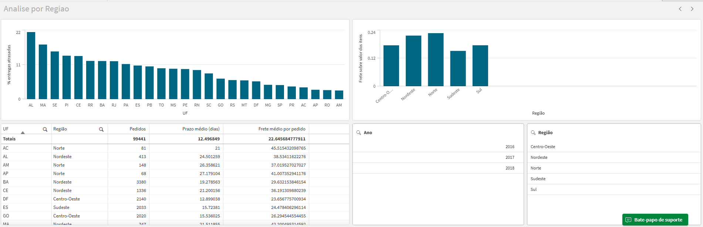
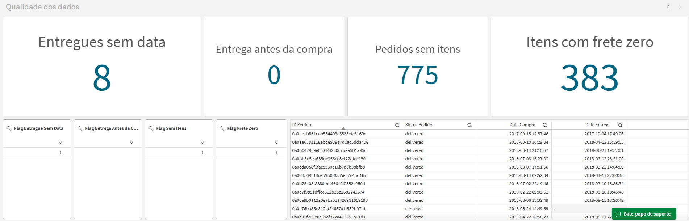

# Dashboard de Indicadores Logísticos — Olist

## 1. Sobre o projeto

Este projeto tem como objetivo desenvolver um dashboard de Business Intelligence para analisar indicadores logísticos de um conjunto público de dados de e-commerce brasileiro.

A solução foi construída no Qlik Cloud Analytics e busca facilitar o acompanhamento de prazos de entrega, atrasos, custos de frete e problemas de qualidade dos dados.

O projeto simula atividades de um analista de Dados e BI, incluindo preparação dos dados, criação de indicadores, modelagem de dados, investigação de divergências e documentação de regras de negócio.

## 2. Objetivos de negócio

O dashboard busca responder às seguintes perguntas:

1. Qual é o prazo médio de entrega e como ele evolui mês a mês?
2. Qual é o percentual de pedidos entregues com atraso?
3. Quais estados e regiões apresentam piores prazos e maiores custos de frete?
4. Quanto o frete representa em relação ao valor dos itens?
5. Quais problemas de qualidade existem nos dados e como foram tratados?

## 3. Tecnologias e ferramentas

- Qlik Cloud Analytics: desenvolvimento do dashboard e análise dos dados.
- Qlik Load Script: carregamento, transformação e criação de campos calculados.
- GitHub: versionamento e documentação do projeto.
- CSV: formato dos arquivos de origem.

## 4. Fonte dos dados

Fonte: Brazilian E-Commerce Public Dataset by Olist, disponibilizado publicamente no Kaggle.

Link da fonte: https://www.kaggle.com/datasets/olistbr/brazilian-ecommerce

O conjunto de dados contém informações de pedidos, clientes, produtos e itens de pedidos.

## 5. Modelo de dados

O modelo foi organizado em quatro tabelas principais:

- Pedidos
- Clientes
- Itens
- Produtos

As tabelas são associadas por identificadores compartilhados, permitindo analisar os pedidos sob diferentes perspectivas.

### Visualização do modelo



## 6. Indicadores implementados

- Quantidade de pedidos distintos.
- Prazo médio de entrega em dias.
- Percentual de entregas atrasadas.
- Frete médio por pedido.
- Frete sobre o valor dos itens.

## 7. Estrutura do dashboard

### Visão Geral

Acompanhamento dos principais indicadores e evolução do prazo médio de entrega ao longo do tempo.



### Análise por Região

Comparação dos indicadores logísticos entre estados e regiões brasileiras.



### Qualidade dos Dados

Identificação e investigação de inconsistências relacionadas a datas, pedidos sem itens e valores de frete.



## 8. Qualidade dos dados

Foram definidos mecanismos para sinalizar:

- Pedidos entregues sem data de entrega.
- Datas de entrega anteriores às datas de compra.
- Pedidos sem itens associados.
- Itens com frete zerado.

Os problemas encontrados, suas causas prováveis e as decisões de tratamento estão documentados na seção 9.

## 9. Principais conclusões

1. Qual é o prazo médio de entrega e como ele evolui mês a mês?

   12,5 dias. O prazo ficou estável em 2017, subiu no começo de 2018 e logo caiu. Hipótese: o pico veio do aumento de pedidos no fim do ano. Também os últimos meses podem estar melhores do que a realidade, porque só entram no cálculo os pedidos já entregues.

2. Qual é o percentual de pedidos entregues com atraso?

   6,79%, sendo que só nas regiões Nordeste e Norte a taxa média de atraso é de 12% e nas demais regiões gira em torno de 6%.

3. Quais estados e regiões apresentam piores prazos e maiores custos de frete?

   Os 5 estados com os piores prazos são RR (29,9 dias), AP (27,2), AM (26,4), AL (24,5) e PA (23,7), contra uma média geral de 12,5 dias. Nesses estados, o frete médio por pedido fica entre R$ 35 e R$ 41, contra R$ 22,65 na média geral. O Norte é a região em que o frete mais pesa em relação ao valor dos itens (cerca de 23%), e o Sudeste a que menos pesa (cerca de 15%).

4. Quanto o frete representa em relação ao valor dos itens?

   No geral, o frete equivale a 17% do valor dos itens. O peso varia por região: é maior no Norte (cerca de 23%) e no Nordeste (cerca de 22%), e menor no Sudeste (cerca de 15%).

5. Quais problemas de qualidade existem nos dados e como foram tratados?

   | Problema | Registros | Causa provável | Tratamento |
   |---|---|---|---|
   | Pedidos entregues sem data de entrega | 8 | Falha de registro na origem (hipótese) | Flag criada; ficam fora do cálculo de prazo e de atraso |
   | Entrega anterior à compra | 0 | — | Flag mantida como validação permanente |
   | Pedidos sem itens | 775 | Pedidos cancelados ou indisponíveis | Flag criada; mantidos na contagem de pedidos |
   | Itens com frete zero | 383 | Possível frete grátis promocional | Flag criada; mantidos nos cálculos |

   Nenhum registro foi apagado. Os problemas foram sinalizados com campos de flag, para que possam ser auditados e levados à área responsável pelo dado.

## 10. Limitações

- Os dados representam uma operação de e-commerce
- A qualidade e a disponibilidade dos campos de origem afetam os indicadores.
- Registros inconsistentes precisam ser investigados antes de qualquer correção.
- As conclusões estão limitadas ao período e às informações disponíveis no conjunto de dados.
- Nenhum registro foi excluído ou corrigido na origem, o tratamento se limitou às transformações feitas no script de carga (conversão de datas, campos calculados e flags de qualidade).

## 11. Estrutura do repositório

```text
projeto-bi-logistica-olist/
├── docs/
│   ├── dicionario-de-dados.md
│   └── regras-de-negocio.md
├── scripts/
│   └── script_carga.txt
├── prints/
│   ├── modelo-de-dados.png
│   ├── visao-geral.png
│   ├── analise-por-regiao.png
│   └── qualidade-dos-dados.png
└── README.md
```